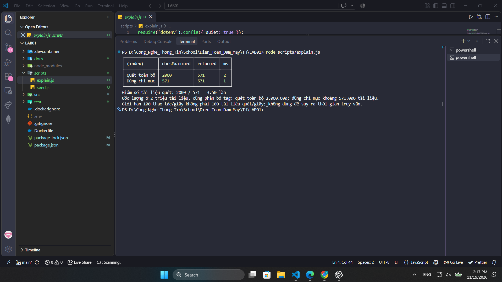
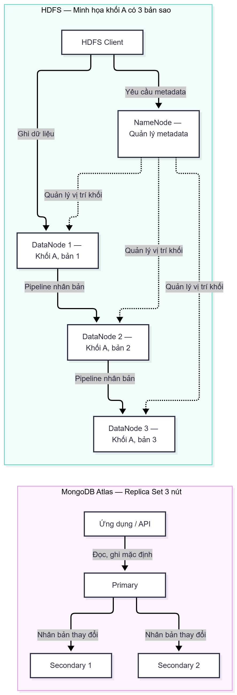
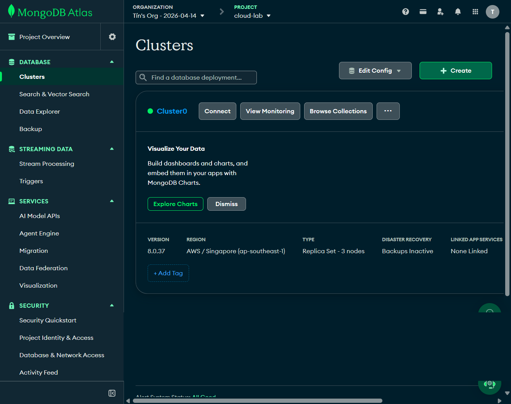

# Bài 3 – Lưu trữ phân tán: NoSQL và lưu trữ đối tượng

Sinh viên: Huỳnh Trung Tín – MSSV 2324802010372.

Ngày thực hiện: 19/11/2026. Mã nguồn: https://github.com/tinhuynh7/notes-api-2324802010372

## Hệ thống thực hiện

API Node.js/Express mở rộng repo bài 2, giữ route `/` và thêm `/notes`. MongoDB Atlas: project cloud-lab, Cluster0, Free, AWS Singapore, replica set 3 nút; user notes_app có quyền readWrite trên database notes. Network Access mở 0.0.0.0/0 theo đề. Supabase: project cloud-lab tại Singapore, bucket attachments Public. API giới hạn upload 2 MB; MongoDB lưu URL tệp. Ba biến cấu hình nằm trong .env được Git bỏ qua.

## Cách tái lập phép đo

Mở terminal PowerShell thứ hai; giữ terminal API đang chạy. Dán:

```powershell
cd D:\Cong_Nghe_Thong_Tin\School\Dien_Toan_Dam_May\TH\LAB01
node scripts/seed.js
if ($LASTEXITCODE -eq 0) { node scripts/explain.js }
git check-ignore .env
git status --short
```

Chỉ tiếp tục khi seed báo đủ 2.000 ghi chú và explain có bảng hai dòng cùng số `returned`.
Script seed chỉ thay các ghi chú có `owner: 'seed'`; không chạy nếu đã dùng giá trị owner này cho dữ liệu cần giữ.
Script explain tạo chỉ mục của model, giữ nguyên các chỉ mục khác; ép truy vấn thứ hai dùng chỉ mục tags để so sánh rõ ràng.

## Kết quả thực nghiệm

Kết quả thực tế của lần chạy trong ảnh:

| Cách truy vấn | docsExamined | returned | ms |
|---|---:|---:|---:|
| Quét toàn bộ | 2.000 | 571 | 2 |
| Dùng chỉ mục | 571 | 571 | 1 |

**Giảm khối lượng quét: 2.000 / 571 ≈ 3,50 lần**, giảm 1.429 tài liệu, tương đương 71,45%. Hai cách trả cùng 571 tài liệu. Thời gian 2 ms và 1 ms chỉ là kết quả lần đo này, không bảo đảm luôn nhanh gấp hai lần.



Tỉ số giảm quét được tính bằng:

`docsExamined (quét toàn bộ) / docsExamined (dùng chỉ mục)`.

Không thay số liệu thực tế bằng số minh họa. Thời gian ms nhỏ hoặc bằng nhau không có nghĩa chỉ mục không hiệu quả.

## Sơ đồ Atlas – HDFS





Ảnh Atlas xác nhận số nút và vùng; không hiển thị riêng vai trò của từng nút. Mô hình của bài là một primary và hai secondary.

Trong VS Code, mở tệp này rồi nhấn Ctrl+Shift+V để xem Markdown Preview.
Sơ đồ HDFS dưới đây minh họa một khối A có ba bản sao; đối chiếu cách trình bày với giáo trình trước khi nộp.

```text
MONGODB ATLAS                         HDFS

       Ứng dụng                         NameNode
          |                        (quản lý metadata)
          v                               |
       Primary                   +--------+--------+
       /     \                   |        |        |
      v       v                  v        v        v
 Secondary Secondary          DataNode DataNode DataNode
                              Khối A   Khối A   Khối A
                              bản 1    bản 2    bản 3

Nhân bản dữ liệu giữa các       Nhân bản từng khối tệp giữa
thành viên replica set.         các DataNode.
```

Giống nhau: dùng các bản sao để tăng khả năng chịu lỗi và tính sẵn sàng khi một nút hỏng.

Khác nhau: Atlas có primary nhận ghi, các secondary sao chép thay đổi và có thể bầu primary mới khi cần.
HDFS có NameNode quản lý tên tệp, vị trí khối và metadata; nội dung khối nằm trên DataNode.
Primary không tương đương NameNode. HDFS có thể có nhiều hơn ba DataNode; hệ số ba áp dụng cho bản sao mỗi khối.
Nhân bản không thay thế sao lưu: xóa nhầm dữ liệu cũng có thể được phản ánh trên các bản sao.

## Câu hỏi phản biện

### 1. Từ 2.000 lên 2 triệu tài liệu

Giữ nguyên phân bố tag và dạng truy vấn, khối lượng quét tăng khoảng 1.000 lần.
Quét toàn bộ cần kiểm tra khoảng 2 triệu tài liệu; chỉ mục cần kiểm tra khoảng 571.000 tài liệu, vẫn giảm khoảng 3,50 lần. Đây là ước lượng theo phân bố tag đã đo, không phải số đo thật trên 2 triệu tài liệu. Truy vấn vẫn trả nhiều kết quả nên còn chi phí truyền dữ liệu; chỉ mục không làm chi phí trở thành hằng số.
Số tài liệu kiểm tra giảm giúp giảm công việc mỗi truy vấn, nhưng thời gian không nhất thiết giảm đúng cùng tỉ số,
vì còn phụ thuộc cache, I/O, tải hệ thống và chi phí truy cập chỉ mục.
Giới hạn 100 thao tác/giây trong đề là giới hạn thao tác, không phải số tài liệu quét mỗi giây;
không thể lấy 2 triệu chia 100 để tính thời gian. Khi tải tăng, truy vấn quét nhiều dữ liệu có thể làm tăng độ trễ và tranh chấp tài nguyên.

### 2. Vì sao lưu tệp ở Supabase và URL trong MongoDB?

Object Storage phù hợp lưu và phân phối tệp qua HTTP. MongoDB giữ metadata ghi chú và URL nên tài liệu nhỏ,
không phải truyền nội dung tệp mỗi lần đọc ghi chú, đồng thời giảm dung lượng database và chi phí nhân bản tệp trong database.
Việc lưu tệp và metadata ở hai dịch vụ cần quản lý tính nhất quán: upload thành công nhưng lưu ghi chú thất bại có thể để lại tệp không được tham chiếu.
Bucket public chỉ dùng cho tệp không nhạy cảm. Mã lab chưa tự xóa tệp Storage khi xóa ghi chú hoặc thay tệp đính kèm.

### 3. Atlas ba nút và HDFS ba bản sao

Mục tiêu chung là giữ nhiều bản sao để dữ liệu vẫn có thể phục vụ khi có lỗi máy.
Atlas nhân bản dữ liệu giữa các thành viên replica set: một primary, hai secondary trong cụm của bài.
Ba thành viên bỏ phiếu có thể duy trì đa số khi một thành viên hỏng, với điều kiện kết nối và cấu hình phù hợp.
HDFS mặc định lưu ba bản sao cho mỗi khối tệp trên các DataNode; NameNode quản lý metadata, không phải một trong ba bản sao khối.
Khả năng phục vụ của HDFS còn phụ thuộc NameNode/HA, không chỉ số bản sao khối.

## Kết quả CRUD và upload – minh chứng đã thu thập

| Thao tác / tình huống | Kết quả thực tế | Ảnh |
|---|---|---|
| POST /notes | 201, trả ghi chú có _id | [Tạo](minh-chung/05-create-201.png) |
| GET /notes?tag=nosql | 200, danh sách đúng bộ lọc | [Danh sách](minh-chung/06-list-200.png) |
| GET /notes/:id | 200, đúng ghi chú | [Chi tiết](minh-chung/07-read-200.png) |
| PUT /notes/:id | 200, tiêu đề đổi thành Lab03 da cap nhat | [Cập nhật](minh-chung/08-update-200.png) |
| POST /notes/:id/attachment | Trả attachmentUrl | [Upload](minh-chung/09-upload-url.png) |
| Mở URL trên trình duyệt | Đúng nội dung tệp minh chứng | [Tệp public](minh-chung/10-public-file.png) |
| DELETE /notes/:id | 204 | [Xóa](minh-chung/11-delete-204.png) |
| GET lại ghi chú đã xóa | 404, Không tìm thấy ghi chú | [Không tìm thấy](minh-chung/12-not-found-404.png) |
| POST /notes với JSON {} | 400, thiếu title bắt buộc | [Dữ liệu sai](minh-chung/13-invalid-400.png) |
| git check-ignore .env và git status --short | .env được bỏ qua, không có trong danh sách thay đổi | [Git](minh-chung/04-git-ignore.png) |

Ghi chú có tệp được giữ lại; thao tác xóa dùng ghi chú riêng.

**URL tệp minh chứng:** [Mở note.txt](https://abljbqudctqgrqodrcve.supabase.co/storage/v1/object/public/attachments/6afea52c72b25219a0b1e547/1795073432972-note.txt).

### Đối chiếu điểm kiểm tra

- [x] Đủ năm thao tác tạo, danh sách, chi tiết, cập nhật, xóa và mã 201/204/404/400 đúng tình huống.
- [x] Tệp đính kèm mở được qua attachmentUrl trong ảnh trình duyệt.
- [x] Bảng console.table có số liệu cả hai cách truy vấn.
- [x] git status không thấy .env; git check-ignore xác nhận tệp được bỏ qua.

Các đánh dấu dựa trên ảnh thực nghiệm, không khẳng định dịch vụ luôn khả dụng tại thời điểm chấm. Dòng .env trong ảnh là kết quả git check-ignore, không phải tệp chờ commit.

## Danh mục minh chứng

Dùng Win+Shift+S, chọn vùng có lệnh, kết quả và mã HTTP; lưu ảnh vào thư mục minh chứng của bạn.

1. `01-explain.png`: terminal có lệnh `node scripts/explain.js`, bảng hai cách truy vấn và tỉ số giảm quét.
2. `02-atlas.png`: Atlas Clusters có Singapore và `Replica Set - 3 nodes`; nếu Metrics hiện vai trò, chụp thêm primary/secondary.
3. `03-atlas-hdfs.png`: chụp sơ đồ và giải thích bên trên trong Markdown Preview.
4. `04-git-ignore.png`: kết quả `git check-ignore .env` và `git status --short`; không mở nội dung .env.
5. Minh chứng phần B: POST 201, danh sách/chi tiết GET 200, PUT 200, DELETE 204, đọc lại 404, dữ liệu sai 400.
6. Upload trả attachmentUrl và trình duyệt mở đúng nội dung tệp. Dùng ghi chú riêng cho upload, giữ URL để kiểm tra.

Ảnh trang `/` chỉ là route bài 1, không thay thế minh chứng CRUD Lab03.

## Commit sau khi kiểm tra

```powershell
git add package.json package-lock.json src test scripts docs/lab03.md docs/minh-chung docs/noi-dung-nop-lab03.txt
git diff --cached --stat
git status --short
git commit -m "Bai 3"
git push
```

Chỉ commit sau khi kiểm tra staged files không có bí mật. Các ảnh chụp cần đính kèm trong bài nộp.
Nộp URL repo/commit, ảnh kết quả explain, sơ đồ và câu trả lời phản biện theo yêu cầu giảng viên.

## Tổng hợp sản phẩm nộp

1. **Commit Bai 3:** chưa tạo/push tại thời điểm tổng hợp; bổ sung URL commit sau bước này. Repository: https://github.com/tinhuynh7/notes-api-2324802010372.
2. **Ảnh kết quả explain.js:** docs/minh-chung/01-explain.png; bảng số liệu 2.000/571, giảm 3,50 lần trong báo cáo.
3. **Sơ đồ Atlas–HDFS:** docs/minh-chung/03-atlas-hdfs.png, kèm giải thích giống/khác và ảnh Atlas 3 nút.
4. **Báo cáo và ba câu trả lời phản biện:** docs/lab03.md này.
5. **Ảnh bổ trợ CRUD, upload và Git:** thư mục docs/minh-chung, tổng cộng 13 ảnh bao gồm ba mục trên.
6. **URL tệp public:** đường dẫn note.txt trong phần kết quả upload; giữ tệp để giảng viên kiểm tra.

Trang nộp yêu cầu dán URL vào ô văn bản, đính kèm ảnh chụp và bảng số liệu. Có thể dùng mẫu docs/noi-dung-nop-lab03.txt. localhost không phải địa chỉ API công khai cho người chấm. Nội dung đề đã cung cấp không yêu cầu triển khai thêm một hosting mới.

Không nộp .env, mật khẩu hoặc secret key. Những mật khẩu từng chia sẻ cần thay trước khi dùng chính thức.
